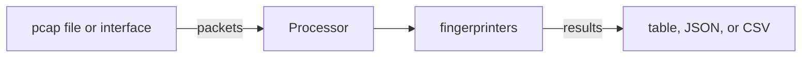

<p align="center"></p>

<h1 align="center">ja4plus</h1>

<p align="center"><b>JA4+ fingerprints from packet captures, live interfaces, and certificates, in Python.</b></p>

<p align="center"><a href="https://github.com/Crank-Git/ja4plus/actions/workflows/test.yml"></a> <a href="https://pypi.org/project/ja4plus/"></a> <a href="https://pypi.org/project/ja4plus/"></a> <a href="https://github.com/Crank-Git/ja4plus/blob/master/LICENSE"></a></p>

<p align="center"><a href="https://crank-git.github.io/ja4plus/"><b>Docs</b></a> · <a href="#install"><b>Install</b></a> · <a href="#quick-start"><b>Quick start</b></a> · <a href="https://github.com/Crank-Git/ja4plus/releases"><b>Releases</b></a></p>



## Why ja4plus

FoxIO owns the JA4+ standard, and [FoxIO](https://foxio.io) publishes it. This library is an independent implementation of that standard. FoxIO wrote no part of it, so for the standard itself, read the [FoxIO JA4+ repository](https://github.com/FoxIO-LLC/ja4).

A JA4+ fingerprint is only worth something if another tool computes the same value from the same bytes. So the FoxIO test vectors decide the output here. The conformance suite runs the committed FoxIO captures against their expected values, and where the reference has a provable defect, the [implementation notes](https://crank-git.github.io/ja4plus/implementation_notes/) record it rather than copy it.

It's pure Python on top of scapy, and it treats every packet as hostile. A parser that can't read a packet returns nothing instead of raising, and every per-connection table has an entry cap and an age limit, so a monitor that runs for a day stops growing.

## Methods

FoxIO publishes twelve JA4+ methods, and this project implements twelve of them. Eleven read traffic that already exists. JA4TScan sends one TCP SYN to each host you name, so it lives apart in the `ja4plus.scan` module and runs as `ja4plus scan`. `JA4LFingerprinter` writes both JA4L and JA4LS, so ten fingerprinter classes carry the other eleven.

FoxIO lists the twelve in [`technical_details/README.md`](https://github.com/FoxIO-LLC/ja4/blob/main/technical_details/README.md).

| Method | Protocol | Description | Implemented |
|------|----------|-------------|-------------|
| JA4 | TLS/QUIC | Client fingerprint from ClientHello messages | Yes |
| JA4S | TLS/QUIC | Server fingerprint from ServerHello messages | Yes |
| JA4H | HTTP | Client fingerprint from request headers and cookies | Yes |
| JA4L | TCP/QUIC | Client-to-server latency, written as `JA4L-C=` | Yes |
| JA4LS | TCP/QUIC | Server-to-client latency, written as `JA4L-S=` | Yes |
| JA4X | X.509 | Certificate structure fingerprint from OID sequences | Yes |
| JA4SSH | SSH | Session type classification from traffic patterns | Yes |
| JA4T | TCP | Client OS fingerprint from SYN packets | Yes |
| JA4TS | TCP | Server fingerprint from SYN-ACK packets | Yes |
| JA4TScan | TCP | Active TCP server fingerprint from SYN-ACK retransmissions, through `ja4plus scan` | Yes |
| JA4D | DHCPv4 | DHCP client/server fingerprint | Yes |
| JA4D6 | DHCPv6 | DHCPv6 client/server fingerprint | Yes |

QUIC v1 and v2 Initial packets (RFC 9001, RFC 9369) are decrypted to reach the ClientHello, TCP payloads are reassembled across segments, and every method reads IPv4 and IPv6. Each method's format, parts, and example value are on its [method page](https://crank-git.github.io/ja4plus/methods/).

## Requirements

- **Python 3.10 or later.** CI runs 3.10 through 3.13.
- **scapy** 2.4.0 or later and **cryptography** 42.0.0 or later. `pip` installs both.
- **The capture privilege** (root, or `CAP_NET_RAW` on Linux) for `ja4plus watch` and `ja4plus scan`. Both run on Linux and macOS.

| Extra | Adds | You need it for |
|---|---|---|
| `lookup` | `requests` | `--lookup-remote` and `JA4DBClient(allow_remote=True)`. The bundled mapping file needs no extra. |
| `scan` | Nothing | `ja4plus scan` runs on the core install. The extra exists so the scanner has one install command. |
| `dev` | pytest, ruff, mypy, build, twine | Running the test suite and building the package. |
| `docs` | mkdocs, mkdocs-material, mkdocstrings | Building the documentation site. |

## Install

<!-- sample: skip the command reaches the Python Package Index -->
```bash
pip install ja4plus

# With the optional remote lookup
pip install "ja4plus[lookup]"
```

## Quick start

```bash
ja4plus analyze capture.pcap
```

This prints a table with one row per fingerprint in the capture. Add `--format json` for one JSON object per line, or `--format csv`.

From Python, `Processor` runs every fingerprinter on each packet:

```python
from scapy.all import rdpcap
from ja4plus import Processor

processor = Processor()
for packet in rdpcap("capture.pcap"):
    for result in processor.process_packet(packet):
        print(result.type, result.fingerprint)
```

## Usage

```bash
# Only some methods, as JSON
ja4plus --format json --types ja4,ja4t analyze capture.pcap

# Name each fingerprint from the mapping file, with no network request
ja4plus --lookup analyze capture.pcap

# Fingerprint a DER or PEM certificate
ja4plus cert server.der

# Show which mapping file the lookup reads, and how many entries it holds
ja4plus db info
```

The interface commands need the capture privilege:

<!-- sample: skip the commands open a capture socket or send packets, and continuous integration holds no capture privilege -->
```bash
# Read an interface until you stop it (`live` is an alias)
sudo ja4plus watch eth0 --bpf "tcp port 443"

# Send one SYN to each host and read its JA4TScan value
sudo ja4plus scan 203.0.113.0/28 --port 443
```

`ja4plus db update` downloads FoxIO's latest mapping file into your cache directory, and `--lookup` reads that copy once it exists. The output options (`--format`, `--types`, `--lookup`, `--lookup-remote`, `--output`, `--force`) work before or after the subcommand. Results go to stdout and diagnostics to stderr, and `--output FILE` refuses to overwrite a file unless you add `--force`. The [output schema](https://crank-git.github.io/ja4plus/output-schema/) has every field, and says where output and errors go.

**Heads up:** `--lookup` never touches the network, but `--lookup-remote` sends each fingerprint the mapping file misses to ja4db.com, which tells that service what your host saw. Read [the remote lookup](https://crank-git.github.io/ja4plus/api_reference/#the-remote-lookup-is-opt-in) before you turn it on.

A fingerprint is evidence of the bytes a packet carried, not of a real client. Anyone can build a ClientHello that produces a well-formed fingerprint, so read [what a fingerprint is evidence of](https://crank-git.github.io/ja4plus/output-schema/#what-a-fingerprint-is-evidence-of) before you trust one from untrusted traffic.

## API

Each fingerprinter also works on its own. `process_packet` returns the fingerprint string, or `None` when the packet produces none:

```python
from ja4plus import JA4Fingerprinter
from ja4plus.ja4db import lookup

fp = JA4Fingerprinter()
for packet in packets:
    if fingerprint := fp.process_packet(packet):
        print(fingerprint, lookup(fingerprint))
```

`lookup` reads the mapping file (your `db update` copy if there is one, otherwise the bundled file) and returns a `LookupResult` or `None`. Several threads can share one `Processor` as long as each thread gets whole connections, which is what `Processor.get_shard_key` is for. The [concurrency page](https://crank-git.github.io/ja4plus/concurrency/) has the full contract, the default bounds, and the memory ceiling. The [public interface](https://crank-git.github.io/ja4plus/api_reference/) covers every class, the one-shot functions, and the certificate helpers.

## Documentation

Everything else is on the [documentation site](https://crank-git.github.io/ja4plus/).

| Page | What's there |
|---|---|
| [Usage guide](https://crank-git.github.io/ja4plus/usage/) | Each fingerprinter with an example, QUIC, capture files, live capture, and the scanner. |
| [Methods](https://crank-git.github.io/ja4plus/methods/) | One page per method: output format, parts, hash rule, and FoxIO source. |
| [Output schema](https://crank-git.github.io/ja4plus/output-schema/) | The JSON and CSV fields, the raw forms, and where output and errors go. |
| [Concurrency](https://crank-git.github.io/ja4plus/concurrency/) | The thread contract, the memory bounds and their defaults, and the memory ceiling. |
| [Public interface](https://crank-git.github.io/ja4plus/api_reference/) | Fingerprinters, `Processor`, the lookup module, and the CLI options. |
| [API reference](https://crank-git.github.io/ja4plus/reference/) | Generated from the docstrings. |
| [Packet throughput](https://crank-git.github.io/ja4plus/performance/) | Measured packets per second. |
| [Migration from 0.6.0](https://crank-git.github.io/ja4plus/migration-0.6-to-1.0/) | Every breaking change in 1.0.0, old form and new. |
| [Implementation notes](https://crank-git.github.io/ja4plus/implementation_notes/) | Every place this project diverges from the FoxIO reference, and why. |

## Development

<!-- sample: skip the first command clones the repository from GitHub -->
```bash
git clone https://github.com/Crank-Git/ja4plus.git
cd ja4plus
pip install -e ".[dev]"
pytest tests/ -m "not spec_validation"   # unit suite
pytest tests/ -m spec_validation         # FoxIO conformance suite
```

The FoxIO vectors are committed under `tests/foxio_vectors/`, so neither suite needs the network. `python tests/download_test_vectors.py` refreshes them from the pinned upstream commit.

## License

This library is released under the **BSD 3-Clause License**.

The JA4+ fingerprinting specifications were created by [FoxIO](https://foxio.io). JA4 (TLS Client) is open source under BSD-3-Clause per FoxIO. The other methods this project implements carry the [FoxIO License 1.1](https://github.com/FoxIO-LLC/ja4/blob/main/LICENSE): JA4S, JA4H, JA4L, JA4LS, JA4X, JA4SSH, JA4T, JA4TS, JA4TScan, JA4D and JA4D6. That license is permissive for academic, internal business, and security research use. FoxIO names each of them at line 5 of [`License FAQ.md`](https://github.com/FoxIO-LLC/ja4/blob/main/License%20FAQ.md), at commit `27f0cbf9fd3000c072f82a0f7d0361dc99acf6c8`. That FoxIO list is wider than this one, because it also names methods this project does not implement.

See [LICENSE](https://github.com/Crank-Git/ja4plus/blob/master/LICENSE) for full details.

## Acknowledgments

JA4+ was created by John Althouse at [FoxIO](https://foxio.io). This library is an independent implementation of the published specification. For the original spec and reference implementation, see [github.com/FoxIO-LLC/ja4](https://github.com/FoxIO-LLC/ja4).

---

<sub>Also in Go: <a href="https://github.com/Crank-Git/ja4plus-go">ja4plus-go</a> · Built by <a href="https://github.com/Crank-Git">Crank</a> · <a href="https://github.com/Crank-Git">More projects</a></sub>
